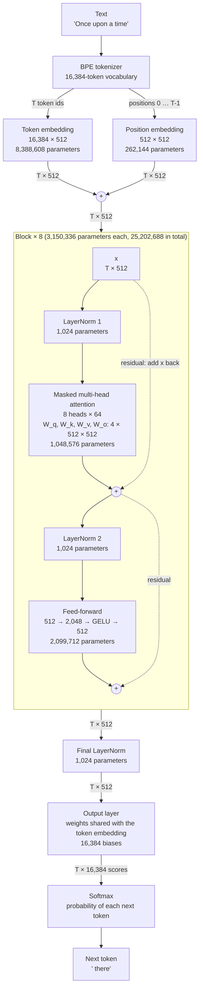

# tiny-gpt

A small GPT language model written from scratch in PyTorch. It is trained on a mix of children's stories,
educational web pages and Python code, and continues the text you start:

> **Once upon a time**, there was a little girl named Lily. She loved to play with her toys and have tea parties.
> One day, she found a big box in her room. She was very excited and wanted to see what was inside.

Stories come out fluent. Web text has good grammar but made-up facts, and code has the right shape
(indentation, `def`, `class`, `self.x = x`) but wrong logic.

## Model

The text flows from top to bottom. T is the number of tokens in the input (at most 512); the shape on each
arrow is the data passed between layers, and each box shows its learned parameters.



The dotted arrows are the residual connections: each block adds its input back after attention and after the
feed-forward layer, so the block computes `x = x + attention(ln1(x))` and then `x = x + ffn(ln2(x))`.

| Setting | Value |
|---|---|
| tokenizer | byte-level BPE, 16,384 tokens (including `<|endoftext|>`) |
| context length | 512 tokens |
| numbers per token (d_model) | 512 |
| attention heads | 8 × 64 |
| FFN hidden size | 2,048 |
| blocks | 8 |

## Parameters: 33,870,848

| Layer | Shape | Parameters |
|---|---|---|
| Token embedding | 16,384 × 512 | 8,388,608 |
| Position embedding | 512 × 512 | 262,144 |
| **Block** (× 8) | | **3,150,336** each |
| &nbsp;&nbsp;LayerNorm 1 | 512 + 512 | 1,024 |
| &nbsp;&nbsp;Attention W_q, W_k, W_v, W_o | 4 × 512 × 512 | 1,048,576 |
| &nbsp;&nbsp;LayerNorm 2 | 512 + 512 | 1,024 |
| &nbsp;&nbsp;FFN layer 1 | 512 × 2,048 + 2,048 | 1,050,624 |
| &nbsp;&nbsp;FFN layer 2 | 2,048 × 512 + 512 | 1,049,088 |
| 8 blocks | 8 × 3,150,336 | 25,202,688 |
| Final LayerNorm | 512 + 512 | 1,024 |
| Output layer | weights shared with the token embedding, + 16,384 biases | 16,384 |
| **Total** | | **33,870,848** |

74% of the parameters are in the 8 blocks and 25% in the token embedding. The output layer reuses the token
embedding (weight tying), which saves 8.4M parameters. Stored as 32-bit floats, `model.pt` is 138 MB.

## Data

| Source | Characters | Documents |
|---|---|---|
| stories: [TinyStories](https://huggingface.co/datasets/roneneldan/TinyStories) | 300M | ~373,000 stories |
| web: [FineWeb-Edu](https://huggingface.co/datasets/HuggingFaceFW/fineweb-edu) (one file) | 700M | ~147,000 pages |
| code: [codeparrot-clean](https://huggingface.co/datasets/codeparrot/codeparrot-clean) (one file) | 500M | ~56,000 Python files |

`data.py` shuffles each source, keeps 1% of it for validation (`data/val_stories.txt`, `data/val_web.txt`,
`data/val_code.txt`) and mixes the rest into `data/train.txt`: 570,752 documents, 1.5 GB, 382.6M tokens.

## Training

| | |
|---|---|
| batches | 16 random windows of 512 tokens; the target is the same window shifted by one token |
| steps | 60,000 (492M tokens, about 1.3 passes over the data) |
| optimizer | AdamW; learning rate warms up to 0.0006 in 1,000 steps, then decays to 0.00006 (cosine); gradients clipped at 1.0 |
| speed | bfloat16 on the Mac's GPU (MPS), 0.4 s per step, about 19,500 tokens per second |
| saving | every 1,000 steps: `checkpoint.pt` (model, optimizer and step, so training can resume) and `model.pt` when the mean validation loss is the best so far |
| time | 7.0 hours |

| Validation | Loss | Perplexity | Next token guessed right |
|---|---|---|---|
| stories | 1.46 | 4.3 | 62.5% |
| web | 3.62 | 37.2 | 35.2% |
| code | 1.85 | 6.3 | 62.9% |

The loss starts at 9.8, close to a random guess among 16,384 tokens (ln 16,384 = 9.7).

## How we got here

The model was built one piece at a time, checking after each piece that the validation loss went down.

**Building the Transformer** on 50,000 made-up sentences ("he is a doctor", "the cow lives on the farm"),
with a vocabulary of 225 words:

| # | What was added | Parameters | Train loss | Val loss |
|---|---|---|---|---|
| 1 | A dummy model: one weight and one bias, trained with AdamW, to learn the training loop | 2 | – | – |
| 2 | Token and position embeddings, softmax and cross-entropy loss | 29,537 | 1.273 | 1.270 |
| 3 | Masked self-attention (one head): each word can look at the earlier words | 45,921 | 0.907 | 0.904 |
| 4 | Multi-head attention (4 heads × 16) | 45,921 | 0.908 | 0.906 |
| 5 | Residual connection: `x = x + attention(x)` | 45,921 | 0.905 | 0.901 |
| 6 | LayerNorm before attention and before the output layer | 46,177 | 0.902 | 0.899 |
| 7 | Feed-forward network (64 → 256 → GELU → 64) | 79,393 | 0.900 | 0.895 |
| 8 | Two Transformer blocks stacked: the same structure as GPT-2 | 129,121 | 0.900 | 0.894 |
| 9 | Byte-level BPE tokenizer written by hand, so the model can read any text | – | – | – |

Attention made the biggest difference. Before it, "he is a" and "she is a" got the same predictions,
because the model saw only the current word.

**Scaling up** on real text, with the same code:

| # | Model | Data | Parameters | Training | Train loss | Val loss |
|---|---|---|---|---|---|---|
| 10 | 4 blocks, d_model 128, 4,096-token BPE | 22.5 MB of TinyStories | 1.86M | 2 minutes | 2.32 | 2.38 |
| 11 | 6 blocks, d_model 384 | 500 MB of TinyStories | 12.3M | 43 minutes | 1.91 | 1.90 |
| 12 | 8 blocks, d_model 512, 16,384-token BPE | 1.5 GB of stories, web text and Python code | 33.9M | 7 hours | 2.52 | 2.30 (stories 1.46, web 3.64, code 1.81) |

The train loss is the average over the last part of training, while the model was still improving, so it is a
little above the val loss of the final model. Train and val staying close means the model is not memorizing the
training data. Row 10 is the exception: with only 22.5 MB of stories the train loss fell below the val loss,
the first sign of memorizing, which is why the next run used 500 MB. In the last row both are averages over the
mixed data.

Along the way the project also got a chat page, temperature, top-k and top-p sampling, and a model report
(`explore.py`). Losses can be compared within the first table (same data and vocabulary), but not between
the two tables, or between rows of the second table that use a different tokenizer or data.

## Files

| File | What it does |
|---|---|
| `data.py` | downloads the three sources and writes `data/train.txt` and the three validation files |
| `bpe.py` | byte-level BPE tokenizer; `python bpe.py` trains `bpe.json` on the first 50M characters of `data/train.txt` |
| `model.py` | the model: `Attention`, `FFN`, `Block` and `GPT` |
| `train.py` | tokenizes the data (cached in `data/*.npy`), trains the model and saves `model.pt` |
| `generate.py` | continues a text, with temperature, top-k and top-p sampling |
| `explore.py` | model report: settings, validation per source, fixed samples and next-token guesses |
| `server.py` | web server for the chat page |
| `frontend/` | the chat page (React) |

## Run

```bash
pip install -r requirements.txt
python data.py                       # downloads about 2.7 GB and writes the data files
python train.py                      # about 7 hours on an Apple-silicon Mac; resumes from checkpoint.pt
python generate.py "def is_prime(n):"
python explore.py                    # model report, to compare models after training
```

The data files are not in the repository; `data.py` downloads them. `bpe.json` is in the repository, so
`bpe.py` is only needed to rebuild the tokenizer.

Chat in the browser:

```bash
cd frontend && npm install && npm run build && cd ..
python server.py
```

Then open http://localhost:8000.
